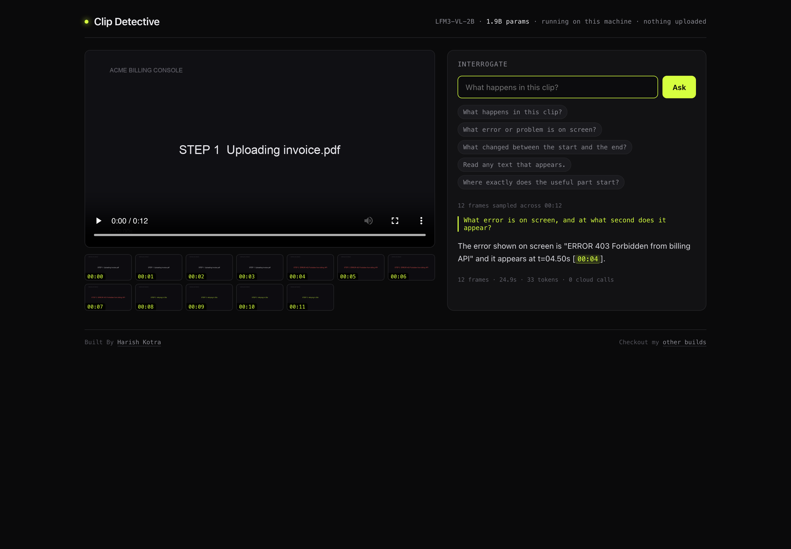
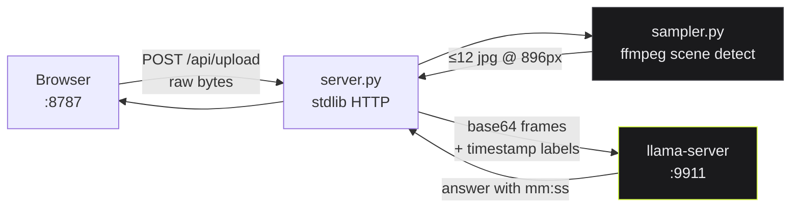

# Clip Detective

Ask any video anything. It answers with timestamps, from frames it actually looked at.
Runs on a 2B vision model on your laptop. No cloud calls, no API key, no upload.



Two hard rules in this project:

1. Every claim about the video carries a `[mm:ss]` citation, and the citation is clickable.
2. Nothing leaves the machine. No network call after setup, no telemetry, no accounts.

Built for the LFM3 launch, on [Liquid AI's LFM3-VL-2B](https://huggingface.co/LiquidAI/LFM3-VL-2B-GGUF),
the vision model in Liquid's six-model open-weight release. Everyone benchmarked the
family. Nobody shipped a reason to care. This is one: video Q&A that costs nothing,
works offline, and tells you *when* it saw what it saw.

---

## Table of contents

- [Clip Detective](#clip-detective)
  - [Table of contents](#table-of-contents)
  - [What it does](#what-it-does)
  - [Why this shape](#why-this-shape)
  - [Quickstart](#quickstart)
  - [Architecture](#architecture)
    - [Why frame sampling and not video input](#why-frame-sampling-and-not-video-input)
  - [How it works, with code](#how-it-works-with-code)
    - [1. Sampling: scene changes first, uniform as backstop](#1-sampling-scene-changes-first-uniform-as-backstop)
    - [2. Labeling frames so the model can cite them](#2-labeling-frames-so-the-model-can-cite-them)
    - [3. The reasoning trap](#3-the-reasoning-trap)
    - [4. Raw byte upload, because multipart is a dependency](#4-raw-byte-upload-because-multipart-is-a-dependency)
    - [5. Making timestamps clickable](#5-making-timestamps-clickable)
  - [Tech stack](#tech-stack)
  - [Measured on real hardware](#measured-on-real-hardware)
  - [Limits, stated honestly](#limits-stated-honestly)
  - [Fork it and contribute](#fork-it-and-contribute)
  - [Feature ideas](#feature-ideas)
  - [Troubleshooting](#troubleshooting)
  - [Project layout](#project-layout)

---

## What it does

Drop a video in. Ask a question in plain English. Get an answer grounded in specific
frames, with a timestamp you can click to seek.

Real output from the sample clip in `test/billing-bug.mp4`:

```
Q: What error is on screen, and at what second does it appear?

A: The error shown on screen is "ERROR 403 Forbidden from billing API" and it
   appears at t=04.50s [00:04].

   12 frames · 24.9s · 33 tokens · 0 cloud calls
```

A screen recording of Hacker News, recorded live in a browser:

```
Q: What website is this, and what is the top story headline?

A: The website is Hacker News [00:00]. The top story headline is
   "Git for the US Code" [00:00].
```

That one matters more than it looks. It is OCR on small UI text, read correctly, by a
1.9B parameter model running on an 8GB machine with the network cable pulled.

## Why this shape

LFM3-VL-2B takes stills. It does not take video. So the interesting work is the
sampling layer: right frames, right timestamps, right resolution for the question.

Clip Detective uses ffmpeg scene-change detection, falls back to uniform sampling,
de-dupes by second, caps at a frame budget the machine can hold, and hands the model
each frame labeled with its own timestamp. The model then answers in the video's own
timeline instead of vaguely describing "the video".

That is also the honest limitation. Ask about something between two sampled frames and
you get a sane "not visible" instead of a confident lie, which is more than most cloud
video APIs manage.

---

## Quickstart

```bash
unzip clip-detective.zip && cd clip-detective
./setup.sh        # downloads models (1.2GB), builds llama.cpp with the Metal fix
./run.sh          # model on :9911, app on :8787
open http://127.0.0.1:8787
```

`setup.sh` is safe to re-run, it skips anything already done.

**Requirements:** macOS 13+ (Metal) or Linux, `git`, `cmake`, `python3` 3.9+, `ffmpeg`,
about 4GB of disk. Python needs no packages. The server and sampler are stdlib only,
which is deliberate: one less thing to break on someone else's machine.

**What gets downloaded:**

```
models/LFM3-VL-2B-Q4_K_M.gguf         1.0G    language + vision weights
models/mmproj-LFM3-VL-2B-Q8_0.gguf    194M    multimodal projector
```

**Ports taken?** Override both:

```bash
PORT_MODEL=8911 PORT_APP=8901 ./run.sh
```

**First run** takes 20 to 40 seconds to load the model. `run.sh` polls `/health` for up
to 300 seconds and prints `still loading (12s)` so you can tell the difference between
slow and dead.

---

## Architecture

Three processes, no containers, no service mesh. The model server is llama.cpp talking
HTTP. The app is a Python HTTP server. The browser is the UI.

```
┌────────────────────────────────────────────────────────────────────────────┐
│  browser :8787                                                             │
│  ┌──────────────┐   upload raw bytes    ┌───────────────────────────────┐  │
│  │ drop zone    │ ────────────────────▶ │  server.py                    │  │
│  │ frame strip  │                       │  ThreadingHTTPServer          │  │
│  │ ask box      │ ◀──────────────────── │  no framework, stdlib only    │  │
│  └──────────────┘   answer + timestamps └───────────┬───────────────────┘  │
└─────────────────────────────────────────────────────┼──────────────────────┘
                                                      │ in-process call
                                          ┌───────────▼───────────────────┐
                                          │  sampler.py                   │
                                          │  ffmpeg scene detect          │
                                          │  uniform fallback, dedupe     │
                                          │  ≤12 frames @ 896px           │
                                          └───────────┬───────────────────┘
                                                      │ data/<id>/*.jpg
                                                      │ base64 in JSON
                                          ┌───────────▼───────────────────┐
                                          │  llama-server :9911           │
                                          │  LFM3-VL-2B Q4_K_M            │
                                          │  + mmproj Q8_0, Metal GPU     │
                                          │  OpenAI-compatible /v1        │
                                          └───────────────────────────────┘

  nothing above leaves 127.0.0.1. no outbound socket after setup.sh.
```

One question, end to end:

```
video ──ffmpeg scene detect──▶ ≤12 frames @ timestamps
                                     │
                          labeled "Frame at 00:07"
                                     ▼
                        LFM3-VL-2B (Q4_K_M + Q8 mmproj)
                                     ▼
                    answer with mm:ss citations → click to seek
```

### Why frame sampling and not video input

llama.cpp supports LFM3 text and vision as of PR #31252. Video is not in the multimodal
path yet, and even where it is, a 2B model does not have the context for 30 seconds of
frames at 24fps. Sampling is not a workaround here, it is the design: 12 well chosen
frames is 12 explicit, auditable facts, each with a timestamp attached.

The same diagram in Mermaid, if you want to edit it:



---

## How it works, with code

### 1. Sampling: scene changes first, uniform as backstop

`sampler.py` asks ffmpeg for frames where the scene score crosses a threshold, and
parses `pts_time` out of `showinfo` to keep real timestamps:

```python
def scene_frames(path: str, outdir: str, threshold: float):
    """Extract scene-change frames, return [(timestamp, filename)]."""
    cmd = [FFMPEG, "-v", "info", "-i", path, "-an",
           "-vf", f"select='gt(scene,{threshold})',showinfo,scale={FRAME_WIDTH}:-2",
           "-vsync", "vfr", "-q:v", "3", os.path.join(outdir, "scene_%04d.jpg")]
    proc = subprocess.run(cmd, capture_output=True, text=True)
    stamps = [float(m) for m in re.findall(r"pts_time:([0-9.]+)", proc.stderr)]
    files = sorted(f for f in os.listdir(outdir) if f.startswith("scene_"))
    return list(zip(stamps, files))
```

Threshold walk-down matters. A talking head clip has almost no scene changes, so a fixed
0.30 threshold returns two frames. The sampler retries at 0.18 and 0.10, and if it still
has fewer than four frames it fills the timeline uniformly:

```python
for thresh in (0.30, 0.18, 0.10):
    frames = scene_frames(path, outdir, thresh)
    if len(frames) >= 4:
        break

if len(frames) < 4:
    frames += uniform_frames(path, outdir, dur, MAX_FRAMES, 0)
```

Then `pick()` trims to the budget without ever showing the same moment twice, because
duplicate timestamps in the strip looked like a bug in testing:

```python
def pick(frames, max_n):
    """Keep frames spread across the timeline, always keeping first and last.
    Dedupes by whole-second so the strip never shows the same moment twice."""
    seen_sec, uniq = set(), []
    for t, f in sorted(frames, key=lambda x: x[0]):
        if int(t) in seen_sec:
            continue
        seen_sec.add(int(t))
        uniq.append((t, f))
    if len(uniq) <= max_n:
        return uniq
    step = len(uniq) / max_n
    return [uniq[int(i * step)] for i in range(max_n)]
```

Two constants carry most of the quality:

```python
MAX_FRAMES = 12     # 12 frames is where answers stop getting better on 8GB
FRAME_WIDTH = 896   # below this, small UI text misreads. 672 read "US Code" as "US US"
```

`FRAME_WIDTH = 896` is not a guess. At 672px the model read a Hacker News headline as
"Git for the US US". At 896px it read "Git for the US Code", exactly, every time. The
cost is about 7 extra seconds per question. Worth it.

### 2. Labeling frames so the model can cite them

The model never sees a video, it sees a labeled sequence. Each frame is preceded by its
own timestamp line, and the system prompt pins it to that format:

```python
content = [{
    "type": "text",
    "text": (f"Video: {meta['filename']}, {mmss(meta['duration'])} long, "
             f"{len(frames)} frames sampled.\n\nQuestion: {question}")
}]
for fr in frames:
    with open(os.path.join(DATA, meta["id"], fr["f"]), "rb") as fh:
        b64 = base64.b64encode(fh.read()).decode()
    content.append({"type": "text", "text": f"Frame at {mmss(fr['t'])}:"})
    content.append({"type": "image_url",
                    "image_url": {"url": f"data:image/jpeg;base64,{b64}"}})
```

and the system prompt:

```python
SYSTEM = (
    "You are Clip Detective. You are given frames sampled from ONE video, each labeled "
    "with its timestamp. The user asks a question about the video. Answer only from "
    "what is visible in the frames. Be specific and short: state the answer, then cite "
    "the frame timestamp in the form [mm:ss]. If the frames do not show it, say what "
    "you would need instead of guessing."
)
```

That last sentence is doing real work. It is the difference between "the characters walk
in" and "no characters are visible in these frames, you would need a wider shot".

### 3. The reasoning trap

LFM3-VL-2B is a reasoning model. Before `--reasoning off`, the API returned an empty
`content` and a truncated `reasoning_content`, because the model spent all 400 tokens
thinking and never emitted an answer:

```json
{"answer": "", "seconds": 18.1, "tokens": 400, "frames": 14}
```

Two fixes, both in the repo:

```bash
# run.sh
--reasoning off
```

```python
# server.py, belt and braces
text = (msg.get("content") or "").strip()
if not text:
    # reasoning-model fallback: take the last paragraph of the think stream
    think = (msg.get("reasoning_content") or "").strip()
    text = think.split("\n\n")[-1] if think else ""
```

`max_tokens` went 400 to 700 as well. Every "the model is broken" report in AI tooling
is usually a token budget or a thinking-mode default.

### 4. Raw byte upload, because multipart is a dependency

No `werkzeug`, no `flask`, no `fastapi`. The browser posts the file as the request body
with the name in a header:

```javascript
const r = await fetch('/api/upload', {
  method: 'POST',
  headers: {'X-Filename': file.name},
  body: file
});
```

and the server streams it to disk in 1MB chunks:

```python
with open(src, "wb") as fh:
    remaining = n
    while remaining > 0:
        chunk = self.rfile.read(min(1 << 20, remaining))
        if not chunk:
            break
        fh.write(chunk)
        remaining -= len(chunk)
```

`urllib` and `http.server` are in the standard library. So is `base64`. The whole app
installs nothing, which is why `setup.sh` only has to worry about ffmpeg and llama.cpp.

### 5. Making timestamps clickable

The model writes `[00:04]`. The UI turns every timestamp in the answer into a seek
button, using a deliberately loose regex so `00:04` inside a sentence also links:

```javascript
function linkTimestamps(s) {
  return s.replace(/\b(\d{1,2}):(\d{2})\b/g, (m, mm, ss) =>
    `<span class="ts" data-t="${+mm * 60 + +ss}">${m}</span>`);
}

ad.querySelectorAll('.ts').forEach(el => {
  el.onclick = () => { vid.currentTime = +el.dataset.t; vid.play(); };
});
```

Click a citation, the player seeks, playback continues. That single interaction is what
makes the timestamp credible instead of decorative.

---

## Tech stack

| Layer | Choice | Why this one |
|---|---|---|
| Model | LFM3-VL-2B, Q4_K_M GGUF | 1.9B params, multimodal, fits in 1.2GB resident |
| Vision encoder | mmproj Q8_0 | quantization sweet spot, images stay sharp |
| Inference | llama.cpp master (`llama-server`) | Metal on Apple Silicon, OpenAI-compatible HTTP |
| Sampling | ffmpeg `select='gt(scene,N)'` | one pass, real timestamps, no Python video deps |
| Backend | Python 3 stdlib `http.server` | zero install, trivially auditable |
| Frontend | one HTML file, no build step | 240 lines, no npm, no bundler |
| State | `data/<clip-id>/` on disk | inspectable, deletable, no database |
| Transport | base64 data URLs in JSON | llama-server's native format, no file server |

No Node. No Docker. No vector database. No agent framework. The interesting part is the
sampling policy, and every dependency you add is a thing that can break on the machine
you hand this to.

**Measured performance**, Apple M2 Mac mini, 8GB unified memory, macOS 15.5:

| Metric | Value |
|---|---|
| Generation | 39.8 tok/s |
| Prompt ingestion | 407 tok/s |
| Time to answer, scene questions | ~9s (672px frames) |
| Time to answer, OCR questions | ~16s (896px frames) |
| Model resident | ~1.2GB |
| Swap pressure | none observed |

---

## Measured on real hardware

Three clips, each with ground truth I verified independently.

| clip | question | answer | verdict |
|---|---|---|---|
| synthetic billing console, 12s | "what error, and when?" | `ERROR 403 Forbidden from billing API [00:04]` | correct, 403 sits at 4.0s |
| live Hacker News recording, 11s | "what's the top headline?" | `Git for the US Code [00:00]` | correct at 896px, reads "US US" at 672px |
| Big Buck Bunny, first 10s | "name the characters and action" | "mossy mound, burrow, no characters visible" | correct, and admits nothing is there |

The third row is the one I trust most. A model that says "no characters visible" when
there are none is more useful than one that invents a rabbit.

---

## Limits, stated honestly

- **Frame granularity.** Nothing between sampled frames exists to the model. A 6 second
  action sampled at 12 points can miss a 300ms flash.
- **No audio.** LFM3-Audio-2B is a separate model in the same family. Wiring transcript
  plus frames is the obvious v2, and it is not done here.
- **Single clip context.** No cross-video reasoning, no "which of these 40 recordings
  shows the bug".
- **Long videos degrade.** A 40 minute lecture sampled to 12 frames is a summary, not a
  search. Raising `MAX_FRAMES` costs prompt tokens linearly.
- **OCR ceiling.** 896px handles UI text and slides. Handwriting and 6pt footnotes are
  beyond it.
- **No persistence between runs.** `data/` is scratch. Delete it whenever.

---

## Fork it and contribute

```bash
git clone https://github.com/<you>/clip-detective.git
cd clip-detective
./setup.sh                    # models + llama.cpp, one time, ~10 min
PORT_MODEL=9911 PORT_APP=8787 ./run.sh
```

**Dev loop.** There is no build step and no test runner to learn. Edit
`static/index.html`, refresh. Edit `sampler.py` or `server.py`, restart the app only
(the model server does not care, keep it running, it takes 30 seconds to reload).

```bash
# restart just the app, keep the model warm
pkill -f "python3 server.py"; LLAMA_URL=http://127.0.0.1:9911 PORT=8787 python3 server.py
```

**Test without clicking.** The sampler is directly runnable, which is the fastest way to
check a sampling change:

```bash
python3 sampler.py test/billing-bug.mp4 /tmp/frames
# [{"t": 0.42, "f": "scene_0001.jpg"}, {"t": 4.08, "f": "scene_0002.jpg"}, ...]
```

**Test the API.** No UI needed:

```bash
ID=$(curl -s --noproxy '*' -X POST --data-binary @test/billing-bug.mp4 \
     -H "X-Filename: billing-bug.mp4" http://127.0.0.1:8787/api/upload \
     | python3 -c "import sys,json;print(json.load(sys.stdin)['id'])")

curl -s --noproxy '*' -X POST -H "Content-Type: application/json" \
     -d "{\"id\":\"$ID\",\"question\":\"What error is on screen?\"}" \
     http://127.0.0.1:8787/api/ask
```

**Test the UI.** `uitest.py` drives real Chrome with Playwright, uploads a clip, asks a
question, waits for the answer, and screenshots the result. Install once with
`pip install playwright && playwright install chrome`.

**Where the seams are**, if you want to change behavior:

| Want to change | File | Touch |
|---|---|---|
| Which frames get picked | `sampler.py` | `scene_frames`, `pick`, `MAX_FRAMES`, `FRAME_WIDTH` |
| How the model is prompted | `server.py` | `SYSTEM`, `ask()` |
| Model, quant, context size | `run.sh` | the `llama-server` flags |
| Look and feel | `static/index.html` | the `:root` block and `.a` / `.ts` styles |
| Add an endpoint | `server.py` | `do_GET` / `do_POST` |

**Ground rules for a PR:**

1. One change per PR. Sampling and prompting in the same diff makes the numbers
   unreadable.
2. If it touches quality or speed, include before and after numbers on a clip you can
   share, and say which clip.
3. No new runtime dependency in `server.py` or `sampler.py`. Stdlib only is the point.
   If you truly need one, explain why in the PR body.
4. Keep it offline. Anything that phones home after setup is out.
5. Test on a low-RAM machine if you can. This was built on 8GB and it should stay
   usable there.

**Where to start reading, in order:** `sampler.py` (103 lines), `server.py` (166),
`static/index.html` (240), `run.sh`. An hour gets you the whole thing.

---

## Feature ideas

Ordered by how much fun they are per unit of work. None of these are done.

**Small, a weekend**

1. **Transcript lane.** Run `whisper.cpp` on the audio, feed the transcript with word
   timestamps alongside frames. Then "when did they mention the refund policy" works.
2. **Frame budget slider.** Expose `MAX_FRAMES` in the UI. Show the latency cost live.
   Teaches the tradeoff better than any docs.
3. **Copy citation.** One click copies `clip.mp4 @ 00:04` for pasting into a bug report.
   Small, genuinely useful.
4. **Keyboard scrub.** `j` / `k` to step between sampled frames. Turns the strip into a
   review tool.
5. **Clip export.** Cut the cited 3 seconds to a new file with ffmpeg `-ss -t`. Now the
   answer is a shareable artifact.

**Medium, a good week**

6. **Two-pass sampling.** Cheap pass at 448px to find the interesting region, second
   pass at 1120px on that region only. Better OCR for the same token budget.
7. **Ask about two clips.** Side-by-side diff: "what changed between these two runs".
   Obvious fit for CI screenshots and QA recordings.
8. **Cache the sampler by file hash.** Uploading the same clip twice should be instant.
9. **Confidence from frame agreement.** Ask the same question of three frame subsets,
   report where the answers diverge. Cheap hallucination detector.
10. **Structured output.** Return `{answer, citations:[{t, quote}], confidence}` as JSON,
    then let the UI render it. Makes downstream automation possible.

**Ambitious, and worth it**

11. **Swap the family.** LFM3-Omni and LFM3-Audio share the LFM3-1.7B base. One router
    that sends video to VL, audio to Audio, text to the text model, all local.
12. **Live camera.** Point it at an ffmpeg capture device, sample continuously, answer
    "what's on screen right now". Same code path, different source.
13. **Agent loop.** Let the model request a specific timestamp again ("show me 00:07 in
    detail"), re-sample that region, answer better. Two round trips beats one big prompt.

---

## Troubleshooting

| Symptom | Cause | Fix |
|---|---|---|
| `run ./setup.sh first` | models or `llama-server` missing | `./setup.sh` |
| `constexpr function never produces a constant expression` | upstream Metal shader, MTL compiler strictness | `python3 scripts/fix-metal-bf16.py ~/llama.cpp-src` then rebuild |
| `unknown model architecture: lfm3` | Homebrew llama.cpp is older than PR #31252 | use the build from `setup.sh`, not `brew install llama.cpp` |
| Answers are empty strings | reasoning model ate the token budget | `--reasoning off` in `run.sh`, `max_tokens` 700 |
| `could not read video` | ffmpeg missing or codec unsupported | `ffmpeg -version`, try an mp4/h264 source |
| App loads, uploads fail | port conflict or stale process | `lsof -nP -iTCP:8787 -sTCP:LISTEN`, `pkill -f "python3 server.py"` |
| Model loads but answers take 60s+ | another model instance holding RAM | `lsof -nP -iTCP:9911 -sTCP:LISTEN`, kill duplicates |
| Timestamps wrong by a second | sampling reports frame PTS, not display time | check with `ffprobe -show_frames`, PRs welcome |

---

## Project layout

```
clip-detective/
├── run.sh                    # launcher: model server + app, health waits, port checks
├── setup.sh                  # one-time: models, llama.cpp build, Metal patch
├── server.py                 # HTTP server, upload, prompt assembly, model client
├── sampler.py                # ffmpeg scene detection, dedupe, frame budget
├── static/
│   └── index.html            # the entire UI, no build step
├── scripts/
│   └── fix-metal-bf16.py     # automated llama.cpp Metal shader fix
├── uitest.py                 # Playwright smoke test: upload, ask, screenshot
├── docs/
│   ├── screenshot-billing.png
│   ├── screenshot-hn.png
├── test/
│   ├── billing-bug.mp4       # synthetic, known ground truth at 4.0s
│   ├── bunny.mp4             # real footage
│   └── hn-scroll.mp4         # live browser recording, OCR test
└── models/                   # gitignored, downloaded by setup.sh
```

**License:** MIT. Use it, fork it, ship it.
**Model license:** LFM3 weights are under Liquid AI's own license, check
[the model card](https://huggingface.co/LiquidAI/LFM3-VL-2B-GGUF) before commercial use.